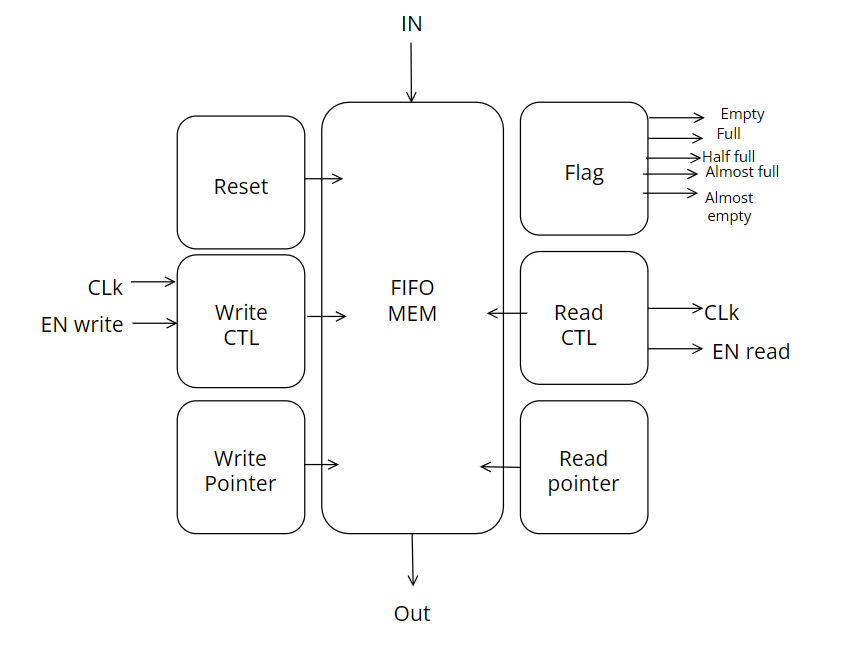

# Project 01: Synchronous FIFO & Verilog Digital Design Suite

## 📌 Overview
This repository contains RTL hardware designs and verification testbenches developed during the **National Telecommunication Institute (NTI)** digital design training. The modules cover fundamental and advanced concepts in synchronous digital systems, finite state machines (FSMs), and memory interface architecture.

---

## 🏗️ Architecture: Synchronous FIFO Memory

  

The core capstone of this module is a parameterizable **Synchronous First-In First-Out (FIFO) Buffer** designed in synthesizable Verilog HDL.

### Key Features:
* **Dual-Port Circular RAM**: Independent simultaneous read and write pointers without read-while-write race conditions.
* **Synchronous Flag Generation**:
  * `full`: Asserts when pointers indicate maximum capacity, preventing data overwrites.
  * `empty`: Asserts when read pointer catches up with write pointer, gating invalid reads.
  * `almost_full` & `almost_empty`: Early watermark status flags for pipeline throttling.
* **Safety Guards**: Includes internal `write_control` and `read_control` submodules that inhibit write strobe when `full == 1` and read strobe when `empty == 1`.

---

## 📂 Source Files & Modules

| Filename | Module Type | Description |
| :--- | :--- | :--- |
| [`rtl/synchronous_fifo_top.v`](rtl/synchronous_fifo_top.v) | Top Module | Complete multi-module Synchronous FIFO implementation with pointer and status logic. |
| [`rtl/alu.v`](rtl/alu.v) | Combinational / Sequential | Parameterized 8-bit Arithmetic Logic Unit with zero-detection output. |
| [`rtl/ram_sipo_piso_alu_system.v`](rtl/ram_sipo_piso_alu_system.v) | Integrated Subsystem | Pipelined datapath integrating RAM, SIPO shift register, PISO shift register, and ALU. |
| [`rtl/seq_detector_mealy_overlap.v`](rtl/seq_detector_mealy_overlap.v) | FSM | Overlapping Mealy sequence detector state machine. |
| [`rtl/seq_detector_mealy_nonoverlap.v`](rtl/seq_detector_mealy_nonoverlap.v) | FSM | Non-overlapping Mealy sequence detector state machine. |
| [`rtl/rising_edge_detector.v`](rtl/rising_edge_detector.v) | Logic & Edge | Moore-style single-cycle pulse rising-edge detector. |
| [`rtl/stream_parity_generator.v`](rtl/stream_parity_generator.v) | Serial Logic | Continuous serial input parity bit generator. |
| [`rtl/light_chaser.v`](rtl/light_chaser.v) | Counter & Display | Configurable frequency clock divider driving an LED ring light chaser. |
| [`rtl/verification_tb.sv`](rtl/verification_tb.sv) | SystemVerilog TB | Testbench verification environment with stimulus generation. |

---

## 📑 Technical Documentation
* Complete architecture specification document: [Synchronous_FIFO_Documentation.pdf](docs/Synchronous_FIFO_Documentation.pdf)
